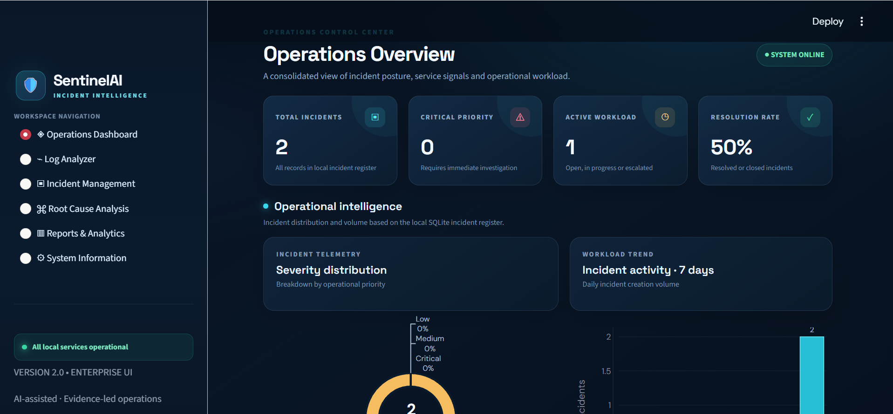
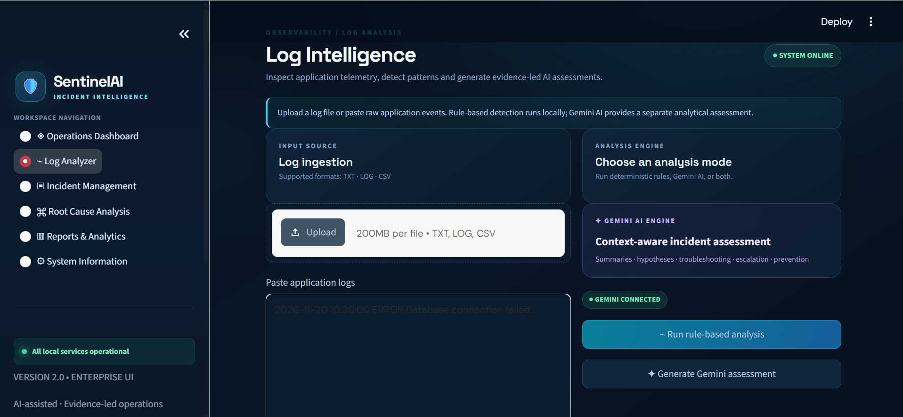
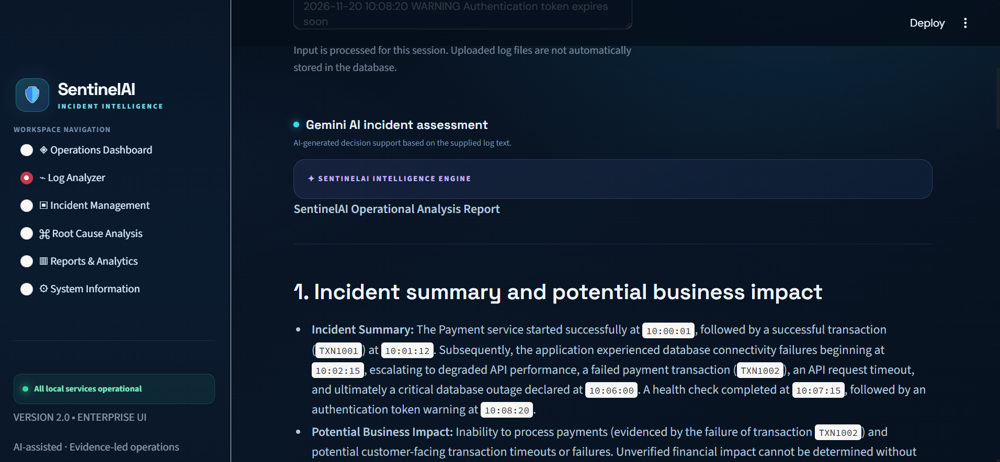
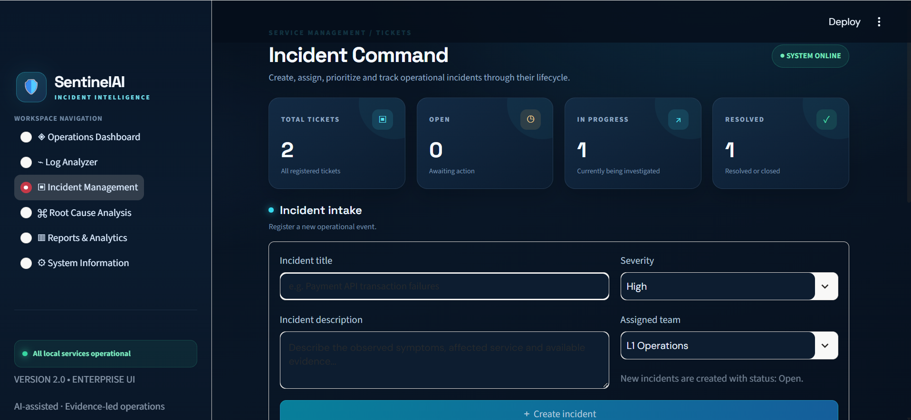

# SentinelAI – AI-Powered Incident Analyzer

**An AI-powered IT incident analysis and troubleshooting platform for IT operations and support teams.**

SentinelAI helps IT support teams analyze application and system logs, identify recurring errors, assess incident severity, investigate possible root causes, and generate troubleshooting recommendations using Google Gemini AI.

---

## Dashboard Preview



## Log Analyzer

Upload or paste log files to identify errors, recurring patterns, and potential issues.



## AI-Powered Incident Analysis

Uses Google Gemini AI to generate incident summaries, possible root causes, troubleshooting steps, and escalation recommendations.



## Incident Management

Create and manage incidents, track their severity, and update their status.



---

## Project Overview

IT operations teams regularly work with large log files and incident records. Manually identifying errors, understanding patterns, and investigating root causes can take significant time.

SentinelAI provides a centralized dashboard and AI-assisted analysis workflow to make these tasks easier.

## Key Features

- **Operations Dashboard:** Displays incident metrics, severity distribution, recent incidents, and incident trends.
- **Log Analyzer:** Supports uploading or pasting TXT, LOG, and CSV log data.
- **Error Detection:** Identifies error keywords, repeated errors, and severity indicators.
- **AI Analysis:** Uses Google Gemini to generate structured incident analysis.
- **Root Cause Analysis:** Presents possible causes, supporting evidence, and investigation steps.
- **Incident Management:** Create incidents, store records, and update incident status.
- **Reports & Analytics:** View charts and export available reports in CSV, TXT, and PDF formats.
- **SQLite Database:** Stores incident records locally.

## Technology Stack

| Component | Technology |
|---|---|
| Programming Language | Python |
| User Interface | Streamlit |
| Data Processing | Pandas |
| Visualization | Matplotlib, Plotly |
| Database | SQLite |
| AI Integration | Google Gemini API |
| PDF Reports | ReportLab |
| Configuration | Python Dotenv |

## AI Analysis Capabilities

SentinelAI uses Google Gemini AI to assist with:

1. Incident summary
2. Error and log patterns
3. Severity assessment
4. Confirmed evidence
5. Unverified assumptions
6. Possible root causes
7. L1, L2, and L3 troubleshooting recommendations
8. Escalation recommendations
9. Preventive measures
10. Final assessment

**Important:** AI-generated root causes and recommendations are suggestions for investigation. They should be validated by the operations team before taking action.

## Application Workflow

1. Open the SentinelAI application.
2. Review incident metrics on the Operations Dashboard.
3. Upload or paste system/application logs.
4. Run log analysis to identify errors and patterns.
5. Generate AI-assisted analysis.
6. Review evidence, possible root causes, and troubleshooting steps.
7. Create or update incidents.
8. Generate reports and export results.

## Installation and Setup

### 1. Clone the Repository

```bash
git clone https://github.com/ganeshjadhav845904/SentinelAI-AI-Incident-Analyzer.git
cd SentinelAI-AI-Incident-Analyzer
```

### 2. Create a Virtual Environment

```bash
python -m venv venv
```

Activate it on Windows:

```powershell
venv\Scripts\activate
```

### 3. Install Dependencies

```bash
pip install -r requirements.txt
```

### 4. Configure Gemini API Key

Create a `.env` file in the project root:

```env
GEMINI_API_KEY=your_gemini_api_key
```

Replace the placeholder with your own Gemini API key.

**Security:** Never upload your actual `.env` file or API key to GitHub.

### 5. Run the Application

```bash
streamlit run app.py
```

The application will open in your browser.

## Database

SentinelAI uses SQLite for local incident data storage. Incident records are stored locally by the application.

## Testing

The application was tested using sample log data and manual workflows, including:

- Log upload and analysis
- Error and severity detection
- AI-assisted incident analysis
- Incident creation and status updates
- Root cause investigation workflow
- Report generation and export
- Dashboard and database functionality

## Limitations

- AI recommendations depend on the quality and completeness of the supplied logs.
- Root cause suggestions require human verification.
- Gemini API access requires a valid API key and internet connectivity.
- The current project is a prototype and is not presented as a production-ready enterprise monitoring platform.

## Future Enhancements

- Real-time log monitoring
- Integration with monitoring platforms
- Automated incident notifications
- Role-based access control
- Advanced anomaly detection
- Integration with IT Service Management (ITSM) tools

## Project Information

**Project Name:** SentinelAI – AI-Powered Incident Analyzer  
**Category:** AI / IT Operations / Incident Management  
**Repository:** [GitHub – SentinelAI](https://github.com/ganeshjadhav845904/SentinelAI-AI-Incident-Analyzer)

---

*Developed as an IT Operations case study project.*